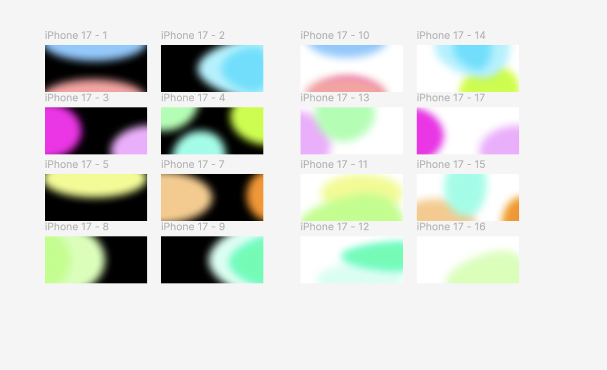
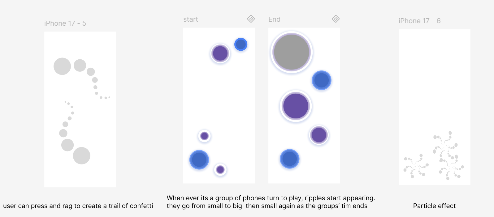

# Week 10 - Moving Forward

## Meeting with Gabriel
Gabriel surprised us by meeting with us in person. We had a productive meeting during which we clarified our plans for the following week and discussed whether he wanted our help continuing development of his version of the project.

We discussed several issues he has noticed while using the application and wishes to improve:
- During testing, he wants to avoid opening one tab per phone client and clicking "Join" in each tab.
- He wants to control the sound output and map it to specific speakers in the sound room at the library, where he will conduct the final performance for his class.
- Add a convenient spacebar shortcut to play and stop the audio.
- Enable live editing of the score through a visual display rather than a JSON form.
- Allow audio files to be fetched from any provider.
- Improve the audio.

## Tasks & GitHub Issues
Gabriel merged the three active pull requests that were waiting for his review in this repository. The merges included:
- Audio effects
- Editor for the JSON score
- Score playback and removing unused features

We added the pain points discussed during the meeting as issues in our forked repository and assigned several of them to team members. We also continued to contribute to Gabriel's repository. At the moment, we have three new pull requests waiting for his review:
- Adding the Electron testing desktop app
- Implementing spacebar playback
- Implementing zoom in and out in the preview timeline

We met up on a Friday to work on these issues together.

## Electron App Executable
The purpose of the Electron app is to allow testing the app without opening a browser and server. The app runs in a desktop environment and makes it possible to test the audio-reactive UI with multiple clients. This eliminates the need to open multiple browser tabs and click "Join" in each one.

We were able to generate executables for Windows and macOS. I uploaded the macOS version to [Google Drive](https://drive.google.com/file/d/1BnCpM8tB0PngeRo3-Nl4-G2_1yD6MV5F/view?usp=sharing).

We will show the app to Gabriel at our next meeting and gather his feedback. Once he approves it, we will upload it to his repository. However, we will wait to see whether he asks us to make changes beforehand.

## Progress on our version of the app
Leah and Sabrina presented their wireframes for the reactive UI to the team:

After viewing the wireframes for the phone view of the audio-reactive UI, Sabrina implemented a first iteration of the UI in our app using p5.js. The team tested it together and was very excited by the result.

## Next Steps
We have three more active issues in the forked repository that we plan to address:
- Fix small issues with sound and effect limits, ranges, and units.
- Fetch or download audio files from a central repository.
- Live-edit the score preview.

We will also continue working on our project. We booked the Holodeck for the presentation day and would like to create an experience similar to the one shown in [Victoria's Pinterest mood board](https://ca.pinterest.com/twentyeighttimes/distributed-listening/?invite_code=1d66dc10fb374c6d849a1e9790a3ef7c&sender=664210782451450500).