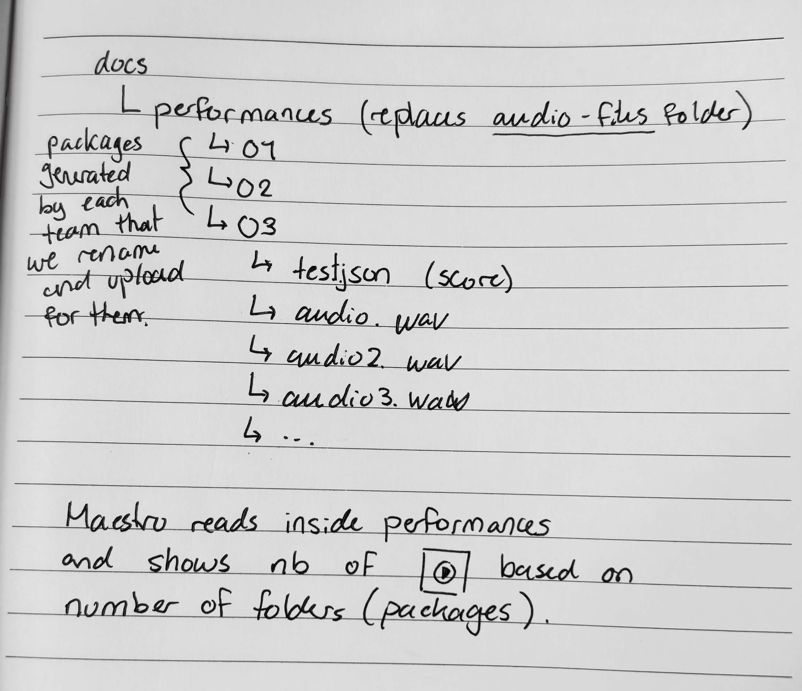

# Week 6 - Coding the interface and necessary features for the submission on Nov 3rd

## Meeting with Gabriel
In this week's meeting with Gabriel, we were able to play a full musical piece from a score created by Eamon with music he composed. We played the piece synchronously on 5 devices and it worked well. Gabriel seemed happy with the progress we made and made the following suggestions for the next steps:
- Before we do any user testing, we have to make sure the latency is dealt with. He suggested pinging each client and having the server calculate the delay so that we can adjust the playback time accordingly.
  - He suggested testing the implementation with a metronome to time the delays perfectly.
- We suggested having a way for users to test the effects they are adding to their piece by allowing sample playbacks of the effects on their sound files directly in the JSON generator form. He approved of this idea.
- He also suggested that we have a page that explains how to use the application.

## Meeting with Sabine
After our meeting with Sabine, we realized a few points that we need to address:
- We need to be able to kick out a user connected to the conductor page. There should only be one conductor at a time, and if a new user tries to connect as a conductor, the previous one should be kicked out. Or, we can hide the conductor button if there is already a conductor connected. 
- We have to have a way to handle the uploading of the sound files and the JSON files properly. 
- We should also be able to disconnect the phones.

## Packaging the audio files and JSON files
We have to make sure that the audio files and the JSON files are packaged properly. Therefore, we decided that when the user uses the JSON generator, they upload their audio files to the form and fill out the fields. When they submit the form, it will download a zip file that contains the audio files and the JSON file. The user can then upload this zip file to the server by sending it to us or Gabriel (someone with write access to the GitHub repo). This way, we can ensure that the audio files and the JSON files are packaged together properly and we can rename the folders so that our application can read the files properly.

## Next Steps
We prioritized the tasks that we need to complete for the first submission. The following is a list of tasks that we need to complete and the person responsible for each task:

- Jess:
  - Landing page
  - Conductor global view + QR code
  - Conductor smaller view
  - Phone logic to be able to kick people out (websocket disconnect)

- Victoria:
  - Be able to upload the sound files in the JSON form so that when the JSON is generated, you get a package that includes all sound files and the JSON.
  - Upload/download package

- Sabrina:
  - Implement CSS for the JSON HTML based on the Figma design
  - Slider for JSON
  - Remove one of the audio file name input fields since we no longer need the file path.
  - Phone pages: add an interaction button and group name. Don’t move the play and pause buttons.

- Leah:
  - Implement HTML page for the guide (user flow explained in detail)
  - Finish all the designs

- Eamon:
  - Restructure folder to accommodate packages
  - Sample sound in the form (low priority/optional)

This is a soft deadline for these tasks, since we have another week before the first submission. Next week, Gabriel will try to come in person to test the application with us during client meetings.

## Communication and Collaboration
We have been using Discord to keep each other updated on our progress and to ask questions. We also use comments directly in Figma to ask questions and clarify the interface. Lastly, the team has the habit of informing others when a person makes a PR and would like it to be reviewed so we are aware of the changes in the repository.
