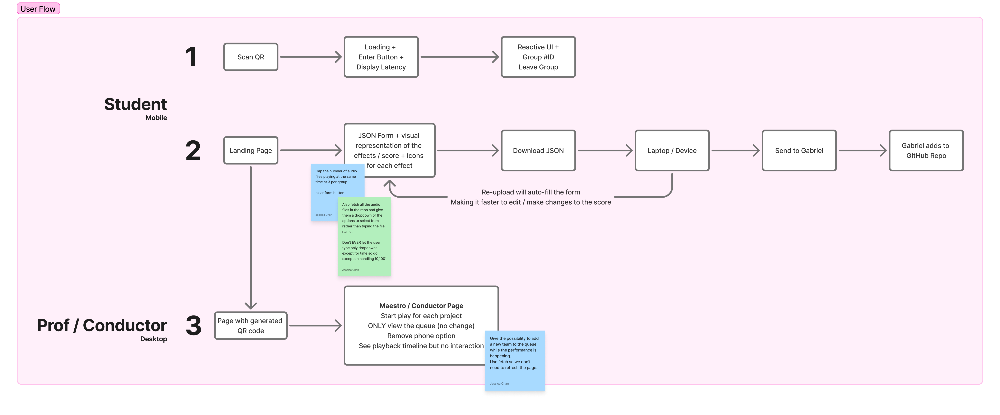

# Week 5 (Reading Week) - Working towards a working prototype
## In Development

### User Flow
We decided we needed to create a user flow diagram to visualize the steps a user would take when interacting with the application to help us identify the necessary components and interactions. 
This allowed us to confirm that everyone was on the same page regarding the functionality and flow of the application.

### Contributions
#### Roles
Our roles in the team has become more established. Leah and Sabrina work on the user interface and user experience. They translate what we defined in the user flow into tangible pages that the rest of the team can work with and develop. Eamon focuses on the sound manipulation and developed the initial format for the JSON score that Sabrina and Victoria used to build the form page that will generate JSON scores with the right formatting. Victoria worked on using the HTML form created by Sabrina to generate the JSON score and download it onto the user's computer. I've taken a more management position and focused on coordinating the work of the team and merging the work into the GitHub repository. The team is working well together and we have clear responsibilities that align with our strengths and interests.

#### Development, GitHub Management & Coordination
I focused on merging the work of the team in the GitHub repository and resolving conflicts that arose from the merging process. I also restructured the front-end code to split the logic that was all in client.js into separate components with clearer responsibilities. This will make it easier for the team to work on different parts of the code without interfering with each other's work.

#### Figma Review 
I also reviewed the Figma design and provided feedback to Sabrina and Leah, mostly to clarify the interactions in certain pages and the intent of certain features. This was important to make sure the pages are eventually ready for development.

### Milestones
1. The JSON score generation is working and the user can download the score onto their computer. 
2. We are able to play a piece of music from the JSON score.
3. We split the front-end code into separate components with clearer responsibilities which will make it easier for the project to scale.